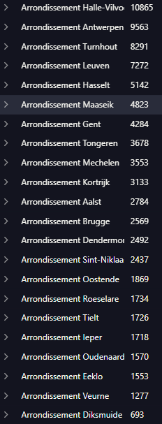
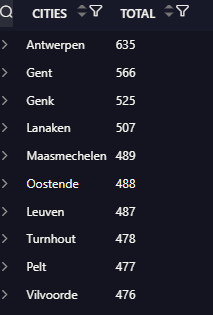
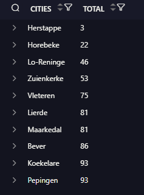

population_2021

GENDERS: 
Distinct Values: 2
Quantity
Masculine - 119847
Feminine - 125875

#### Code used

SELECT `CD_SEX`AS SEX, COUNT(`CD_SEX`) AS TOTAL
FROM population_2021
GROUP BY `CD_SEX`

NATIONALITY
Distinct values: 2
Quantity
Belgen - 165696
niet-Belgen - 83026

#### Code used
SELECT 
  ` TX_NATLTY_NL` AS NATIONALITY, 
  COUNT(`TX_NATLTY_NL`) TOTAL
FROM population_2021
GROUP BY NATIONALITY
ORDER BY TOTAL DESC

Foreigners per city

#### Code used
SELECT `TX_ADM_DSTR_DESCR_NL` AS PROVINCES, 
COUNT(`TX_NATLTY_NL`) AS TOTAL_NOT_BELGIAN
FROM population_2021
WHERE `TX_NATLTY_NL` = 'niet-Belgen'
GROUP BY PROVINCES
ORDER BY TOTAL_NOT_BELGIAN DESC

TOP 10
Cities with the most foreigners:

#### Code used

SELECT 
  `TX_DESCR_NL` AS CITIES, 
  COUNT(`TX_NATLTY_NL`) AS TOTAL
FROM population_2021
WHERE `TX_NATLTY_NL` = 'niet-Belgen'
GROUP BY CITIES
ORDER BY TOTAL
LIMIT 10

Cities with the least foreigners:

#### Code used

SELECT 
  `TX_DESCR_NL` AS CITIES, 
  COUNT(`TX_NATLTY_NL`) AS TOTAL
FROM population_2021
WHERE `TX_NATLTY_NL` = 'niet-Belgen'
GROUP BY CITIES
ORDER BY TOTAL DESC
LIMIT 10

Average age of foreigners
Commom Sex
Common civl status
