## Part 1 — Basic Data Quality

### 1. Dataset Structure
> How many rows are in the dataset?

  -> There are 1000 entries.
  #### Code Used
    df.info()

> How many columns are in the dataset?

  -> There are 11 columns
  #### Code used

    df.info()

> What are the names of all columns?

  -> Student_id, class_id, monthly_fee, course, teacher_id, student_status, total_course_modules, enrollment_date, age, student_email
  ####  Code used 
    df.info()

>What data type does Pandas assign to each column?

  -> object
  #### Code used
    df.dtypes

> Which columns have an incorrect data type for their intended purpose?

  -> monthly_fee, total_course_modules, completed_modules, enrollment_date, age

### 2. Missing Values

> How many missing values are present in each column?

  → Student_id: 40

  → class_id: 37
  
  → monthly_fee: 26
  
  → course: 29

  → teacher_id: 37

  → student_status: 37

  → total_course_modules: 32

  → enrollment_date: 51

  → age: 38

  → student_email: 31

> Which column contains the highest number of missing values?

  → total_couse_modules with 51 missing values

> What percentage of the dataset is affected by missing values in each column?

  → 39.90% of the dataset is affected by missing values and the missing values in each column vary from 2.60% to 5% missing values.

  #### Code used
    def percentage_dataset(value):
    result = (value / len(df)) * 100
    return f"{result:.2f}%"

> Are there empty strings ("") that Pandas does not automatically recognize as missing values?

  → No. 
  #### Code used: 

  ##### Creating a list that identifies possible empty string values
    sus = ["", "  ", "" "", '', ' ' ]
  ##### Creating a mask that test each row 
    mask = df.apply(lambda col: col.astype(str).str.strip().isin(sus))
  ##### Performing the test and getting the result
    df[mask.any(axis=1)] #Result FALSE

> After treating empty strings as missing values, how does the missing-value count change?

  → No empty values were found.

#### Visualization
> Create a bar chart showing the number of missing values per column.

  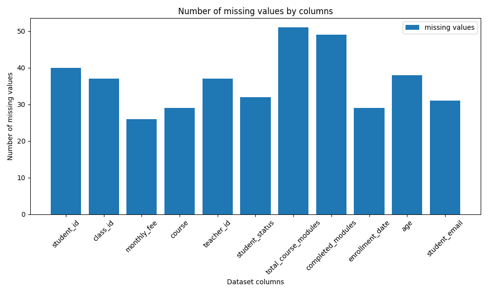

### 3. Duplicate Records
> How many completely duplicated rows exist?

  → 31 completely duplicated

  #### Code used
    df.duplicated().sum() 
    returned 31

> What percentage of the dataset consists of duplicate rows?

  → 3.10%

  #### Code used
    def percentage_dataset(value):
    result = (31 / len(df)) * 100
    return f"{result:.2f}%"
  
> After removing exact duplicates, how many rows remain?

  → 969
  #### Code used

  ##### Remove duplicates and save new dataset in a new variable:
    df2 = df.drop_duplicates() 
  ##### return the number of rows and columns (969, 11):
    df2.shape 

> Are there students who appear more than once based on student_id?

  → Yes, 129 duplicatas.
  #### Code used
    df2.duplicated(subset = "student_id").sum()

> Are duplicated student IDs always exact duplicates, or do some contain different information?

  → They are not exact duplicates. Some contain different information.

## Part 2 — Standardization and Consistency

### 4. Student IDs
>How many different formats are used for student_id?
  → There are **839** different formats
  #### Code used
    df2["student_id"].value_counts()

> How many IDs contain unexpected spaces, lowercase characters, periods, slashes, or other special characters?

  → Out of 969 student ids, **861** contains special characters, lowercases, periods, slashes, etc.
  #### Code used

  ##### Defining the right ID pattern:
    standard_student = r'^[A-Z]{3}[0-9]{4}$'

  ##### Testing the ids and returning the non-valid ids sum in a variable invalid_ids_format:
    invalid_ids_count = (
    ~df2["student_id"]
    .astype(str)
    .str.strip()
    .str.match(standard_student, na=False)).sum()

> How many student IDs appear to be invalid?

  → Valid ids criteria:

  - 7 characteres;
  - Composed by 7 characteres (3 letters 'STU' and 4 numbers '0-9')

  Out of this criteria, there were found **236** invalid ids.

  #### Code used

  ##### Creating a mask that filters the ids based on the criteria for invalid ids
    invalid_ids_criteria = (
    df2["student_id"].astype(str).str.match(r'^.{0,6}$', na=False) | #less than 7 characteres
    df2["student_id"].astype(str).str.match(r'^[A-Za-z]+$', na=False) | #Composed by only letters
    df2["student_id"].astype(str).str.match(r'^[0-9]+$', na=False) #Composed by only numbers
)

> Can you create a standardized student_id format?
  → The following standardized student_id format was created: 'STU0001'

  #### Code used

  ##### Extracting the 3 letters STU and the 4 numbers 0000 from the recorded valid ids.
    standard_id = df2["student_id"].str.extract(r'^([A-Z]+)[^0-9]*([0-9]+)$')

  ##### Applying the standardization to the student id column
    df2['student_id'] = (
      standard_id[0].str.upper() +
      standard_id[1].str.zfill(4)
    )

> After standardization, how many unique students remain?

  → There are **839** unique students.

  #### Code used
      df["student_id"].nunique()

 **Target format:** _STU0001_, _STU0002_, _STU0003_

### 5. Class IDs
> How many unique classes are present in the dataset?

  → There are 778 unique classes.

  #### Code used
    df["class_id"].nunique()

> What years appear in __class_id__?

   → '2015', '2017', '2026', '2018', '2023', '2024', '2019', '2025','2021', '2022', '2009', '2027', '2010', '2028','2020', '2008'

   #### Code used

   ##### Splitting the string by '-' and saving the years in a new column 'class_year'
    df2["class_year"] = df2["class_id"].astype(str).str.split("-").str[1]

  #### Returning the unique years
    df2["class_year"].nunique()

> Are there classes older than the theoretical 10-year limit?

   → No, the oldest class is dated in 2008.

   #### Code used
      pd.Series(df2["class_year"].unique()).sort_values()

> Are there classes with future years?

   → Yes. Classes for 2027 (20) and 2028 (9 classes) 
  #### Code used
    df2["class_year"].value_counts()

> How many class IDs are malformed or impossible to interpret?

   → **82** ids were found impossible to interpret or malformed

   #### Code used

  ##### Defining a valid class id standard: 

    valid_class = r'^C-[0-9]{4}-[0-9]{3}$

  ##### Creating a mask to filter valid or invalid ids

    mask = df2["class_id"].str.match(valid_class, na=False)

  #####  Getting the sum for invalid ids
    ~mask.sum()

> How many students are associated with invalid or suspicious classes?
   
   → 67 distinct students are associates with invalid/suspicious classes.

   #### Code used

   ##### Filtering student_ids and class_ids and saving it in a variable "student_class" 
    student_class = df2[~mask][["student_id", "class_id"]]
    student_class.shape 

  ##### Creating a mask to remove temporarialy null student_ids
    mask_1 = student_class["student_id"]
      .astype(str)
      .str.match(r'^STU[0-9]{4}$')

> Which class has the highest number of students?
   
   → The class **C-2027-001** has the highest number of students (17), followed by **C-2015-999** (16) and **C-2009-777** (7)
  
  **__obs__**: By removing duplicated student_ids we still have the same results but now **C-2027-001** with 16 students.

   #### Code used

   ##### Adding a new criteria for the mask to return only non-null student_ids, class_ids (and non-duplicated).
    mask = df2["class_id"].astype(str).str.match(valid_class) &     df2["student_id"].astype(str).str.match(student_id_pattern) #&   ~df2["student_id"].duplicated() 

  ##### Counting the most frequent class_id
    student_class["class_id"].value_counts()

#### Visualization
>  a chart showing the number of records per class year.
  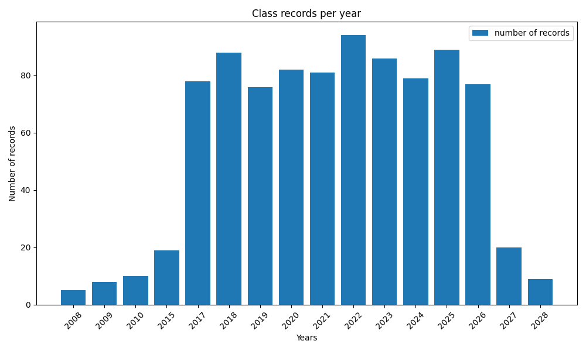

  #### Code used
    class_year_viz = (
      df2["class_year"]
      .value_counts()
      .reset_index(name="number_of_records")
      .rename(columns={"class_year": ""}))

  ##### Sorting data
    class_year_viz = (
      class_year_viz[class_year_viz['year'].astype(str).str.match(r'^[0-9]{4}$')]
      .sort_values(by='year'))

  ##### Making a bar graph

    fig, ax = plt.subplots(figsize=(10, 6))

    plt.bar(class_year_viz["year"], class_year_viz["number_of_records"], label = "number of records")

    plt.xlabel("Year")
    plt.ylabel("Number of records")
    plt.title("Class records per year")

    plt.legend()

    plt.xticks(rotation=45, ha="center") 
    plt.tight_layout() 
    plt.show()

### 6. Course Names
> How many unique values currently exist in the course column?

   → **47**

   #### Code used
    df2["course"].nunique()

> How many actual courses should exist?
  → 8 courses: Dutch, English, French, German, Italian, Japanese, Portuguese, Spanish 

  #### Code used

  ##### Creating a mask
    mask_full = df2["course"].str.len() >=4

  ##### Applying mask and seeing results
    df2[mask_full]["course"].sort_values().unique()

> Which values are abbreviations?

  → 'DE', 'EN', 'ES', 'Eng', 'FR', 'Fr.', 'Frnch', 'Ger.', 'IT', 'Ital.', 'JP', 'Jap.', 'NL', 'Neth.', 'PT', 'Port.', 'Span.'

  #### Code used

  ##### Adapting the mask
    mask_abreviations = df2["course"].str.len() <=5

  ##### Applying mask and seeing results
    df2[mask_abreviations]["course"].sort_values().unique()

> Which values are misspelled?

  → Englsh, English123, Germ@n, Dutchh, Frnch, Japaneze

  #### Code used
    df2["course"].value_counts()

> Which values differ only because of capitalization or extra spaces?

  → Englsh - english, German - german, Portuguese - portuguese, Italian - italian, Japanese - japanese, French - french, Dutch - dutch, Spanish - spanish
  
  #### Code used
    df2["course"].value_counts()

> Can you standardize all course names?

  → Yes, the names were standardized with starting with capital letters.

  #### Code used

  ##### Mask to identify abreviations
      mask_abreviations = df2["course"].str.len() <=5
      df2[mask_abreviations]["course"].sort_values().unique() 

  ##### Cleaning unnecessary chacacteres and extra spaces
      df2.loc[:, "course"] = df2["course"].astype(str).str.strip().str.replace(r"[^A-Za-z]", "", regex=True)

  ##### Grouping different English course records and replacing all for ENGLISH
      mask_en =   df2["course"].astype(str).str.startswith("EN",na=False)
      df2.loc[mask, "course"] = "English"

  ##### Creating a dictionary that maps certain abreviations and misspelled languages to their correct ones
    course_val = {"JP": "Japanese", 
      "FR":"French",  
      "NL":"Dutch", 
      "ES":"Spanish", 
      "JAP":"Japanese",
      "DE":"German", 
      "PORT":"PORTUGUESE",
      "ITAL":"Italian",
      "NETH":"Dutch",
      "PT":"Portuguese",
      "IT": "Italian",
      "SPAN":"Spanish",
      "DUTCHH":"Dutch",
      "GER":"German"
   }

  ##### Replacing last abreviations and misspelled words according to the dictionaty
    df2["course"] = df2["course"].replace(course_val)

> How many unique courses remain after cleaning?
  → 8 unique courses appear and one Null category after cleaning.

  #### Code used
    df2["course"].value_counts()

> Which course has the highest number of students?
  → English

  #### Code used
  ##### Creating a new variable course_stu
    course_stu =  df2["course"].value_counts().reset_index()
    course_stu.columns = ["course","total_students"]

#### Visualization
> Create a bar chart showing the number of students per standardized course.
  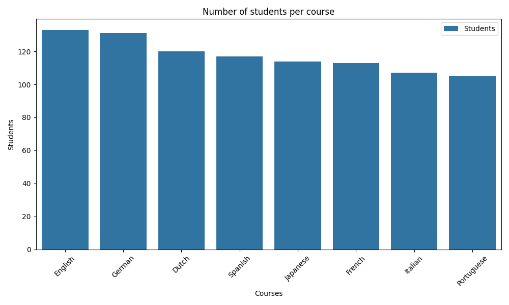

  #### Code used
    fig, ax = plt.subplots(figsize=(10, 6))

    sns.barplot(data = course_stu, x="course", y="total_students", label="Students")

    plt.title("Number of students per course")
    plt.xlabel("Courses")
    plt.ylabel("Students")

    plt.xticks(rotation = 45, ha= "center")
    plt.tight_layout()

    plt.show()

## Part 3 — Teachers and Classes

### 7. Teacher IDs
> How many unique teachers are recorded?
  
  → **490**

  #### Code used
    df2["teacher_id"].nunique() 

> How many teacher IDs contain formatting problems?

  → **659**

  #### Code used
  ##### Creating a mask that groups all ids starting with the standard TCH
    mask_misspelled =  (df2["teacher_id"].astype(str).str.upper().str.startswith(("TCH"), na=False))

  ##### Applying the mask to the dataset and saving results in avariable mis_ids
    mis_ids = df2[mask_mispelled]["teacher_id"]

  ##### Checking the length of the valid ids and the ones with formatting problems
    len(mis_ids[mask]) # 106 valid ids
    len(mis_ids[~mask]) # 659 ids with formatting problems

  ### Using value_counts to look for unique values and duplicates or non-valid ids starting with 'TCH'
    mis_ids.value_counts()

> How many teacher IDs appear to be invalid?

  → **222**

  #### Code used

  #### Using ~mask_mispelled to get the invalid ids and using length function to return the quantity of invalid ids
    len(df2[~mask_mispelled]["teacher_id"]) #Returned 204 + 18 from an invalid string caught in .value_counts() in formatting problems

> Are there teachers represented by multiple ID formats?

  → Yes, due to id formatting issues.

  #### Code used

  ##### Standardizing ids in a temporary column
    df2["teacher_id_clean"] = (
    df2["teacher_id"]
    .astype(str)
    .str.upper()
    .str.replace(r"[^A-Z0-9]", "", regex=True)
)
  ##### Grouping unique clean ids and their respective raw formats
    multiple_ids = df2.groupby("teacher_id_clean")["teacher_id"].unique()

  ##### Visualizing ids
    multiple_formats = multiple_ids[multiple_ids.apply(len) > 1] 

> After standardizing teacher IDs, how many unique teachers remain?

  → **85**  

  #### Code used
    df2["teacher_id"].value_counts()
    
### 8. Teacher–Course Consistency
> Are teachers consistently associated with the same course?

  → No. Teachers ussually appear teaching multiple languages.

  #### Code used

 ##### Grouping the columns teacher_id and aggregating unique courses related to unique teacher_ids

    teacher_course = df2.groupby("teacher_id")["course"].unique().sort_values(ascending=False)

  ##### Filtering techers with more than one language course

    teacher_course_filter = teacher_course[teacher_course.apply(len) >  1].reset_index()

  ##### Number courses per teacher: Creating a new column with the quantity of courses per teacher

    teacher_course_filter["number_of_course_per_teacher"] = teacher_course_filter["course"].apply(len)

  ##### Sorting values

      teacher_course_filter.sort_values(by='number_of_course_per_teacher', ascending=False).head(30)

> How many teachers are associated with more than one language/course?

  → **85**

  #### Code used

  ##### Checking length using teacher_course_filter variable

    len(teacher_course_filter) #85

> Which teacher is associated with the highest number of different courses?
   
   → There are 9 teachers who teach all the 8 languages offered by the school. 

   ##### Ids: 

    TCH0004, TCH0017, TCH0012, TCH0011, TCH0008, TCH0057, TCH0061, TCH0060, TCH0040                             
    
  #### Code used

  ##### Creating a new column with the quantity of courses per teacher

    teacher_course_filter["number_of_course_per_teacher"] = teacher_course_filter["course"].apply(len)

  ##### Sorting values
    teacher_course_filter.sort_values(by='number_of_course_per_teacher', ascending=False).head(30) 

> Are multiple-course teacher assignments necessarily errors?

   → Not necessarily. In the context of a language school, it is normal that some teachers may have knowledge of more than two languages.

  #### Code used

  ##### Using value_counts() to count unique values in the column number_of_course_per_teacher

    teacher_course_filter["number_of_course_per_teacher"].value_counts()

> Explain your reasoning rather than automatically removing these records.

   → Analyzing the whole context of the school and the number of unique teacher_ids, it was found that around 82.35% of the teachers teach between 4 and 7 languages each, and a portion of 10.59% teach the 8 languages offered by the school. Nevertheless, this is not necessarily seen as a data inconsistency, but rather as a reflection of the flexibility and versatility that the school's teaching staff possesses and requires.

   ##### Calling a function to calculate the percentage of the amount of courses assigned to teachers
    def percentage_dataset(value):
  result = (value / len(teacher_course_filter)) * 100
  return f"{result:.2f}%"

### 9. Teacher–Class Consistency

> Does each class have only one teacher?

   → No, 65% of classes have around 1 teacher, but there are 10 unique class_id linked to 2 and 10 teachers.

   #### Code used
  ##### dropping all nan values from the dataset and saving result in a new 

    df2_clean = df2.dropna()

  ##### Creating a group of teachers and classes they teach in

    class_teacher = df2_clean.groupby("class_id")["teacher_id"].nunique().reset_index()

    teacher_class.columns = [ "teacher_unique_id","class_per_teacher"]

  ##### Creating a column with the number of class per teacher
    teacher_class["total_class"] = teacher_class["class_per_teacher"].apply(len)
    teacher_class.sort_values(by='total_class', ascending=True).head(30)

  ##### Using value_counts() to count unique values
    class_teacher["total_class"].value_counts()

> How many classes have multiple teachers?

   → Around 10 classes have multiple teachers.

   #### Code used
  ##### Analaysing if there is any class with multiple teachers
    class_teacher = df2_clean.groupby("class_id")["teacher_id"].unique().reset_index()

    class_teacher.columns = [ "class_unique_id","teacher_per_class"] 

  ##### Using value_counts() to count unique values
    class_teacher["total_teacher"].value_counts() 

> How many teachers are assigned to classes associated with different courses?

   → **80**

   #### Code used

  ##### #Grouping "teacher_id" e "course" unique values
    teacher_class_course = df2_clean.groupby("teacher_id")["course"].nunique().reset_index()
    teacher_class_course.columns = ["teacher", "sum_different_course"]

  ##### Filtering teacher with multiple classes and different courses
    multiple_teacher_course = teacher_class_course[teacher_class_course["sum_different_course"] > 1] 

  ##### Getting quantity of teachers with multiple classes and different courses
    len(multiple_teacher_course) #80

> Can you identify potential teacher/class mismatches?

   → Potential teacher-class mismatches were noticed specially concerning to missing information. Some teachers are not identified in the class and vice-versa. Such mismatches were found by sorting teacher_id and class_id out and checking null values in both columns. It was also found that there are 10 class_ids linked to multiple teachers and two of those class_ids were linked to 10 unique teacher_ids.

   #### Code used

  ##### Analasying if there is any class with multiple teachers
    class_teacher = df2_clean.groupby("class_id")["teacher_id"].unique().reset_index()

    class_teacher.columns = [ "class_unique_id","teacher_per_class"] 

  ##### Using value_counts() to count different values
    class_teacher["total_teacher"].value_counts()

> How many records contain a possible inconsistency between:
#### Teacher → Class → Course
   → **47**. Overall there was found 47 records that contains inconsistencies either in classes with multiple teachers or mutiple courses assigned to a unique class_id.

   #### Code used
  ##### Saving classes ids with inconsistencies
    inconsistency_class_teacher_course = class_teacher[class_teacher["course"] > 1]

  ##### Converting classes ids to list
    list_multiple_teacher_class = inconsistency_class_teacher_course["class_id"].tolist() 

  ##### Creating a filter
    inconsistent_class = df2_clean[df2_clean["class_id"].isin(list_multiple_teacher_class)]

  ##### Printing ids with their assignments: teacher, class and course
    inconsistent_class[["teacher_id", "class_id", "course"]]

  ##### Returning the length of records
    len(inconsistent_class)

## Part 4 — Logical Data Validation

### 10. Student Status
> How many unique values exist in student_status?

   → **13**
  #### Code used

  ##### Getting unique values
    df2["student_status"].nunique()

> Which values represent the same status but use different spellings, abbreviations, or capitalization?

   → **Pending**: PEND, ?, pendingg

   → **Enrolled**: ENR, enrol, enrolled, E

   → **On hold**: trancado, on-hold
  
  #### Code used
  ##### Getting unique value counts
    df2["student_status"].value_counts()

> Can you standardize all statuses into:

 **_Enrolled - Pending - On Hold_**

  #### Code used
  ##### Removing extra spaces and setting all to lower and then capitalizing
    df2["student_status"] = df2["student_status"].astype(str).str.strip().str.lower().str.capitalize()

  ##### Standadizing 
    student_status_list = {"Enr":"Enrolled",
                       "Pend":"Pending",
                       "Trancado":"On hold",
                       "Enrol":"Enrolled",
                       "Pendingg":"Pending",
                       "E":"Enrolled",
                       "?":"Pending",
                       "On-hold":"On hold"
                       }
  ##### Replacing misspelled values for the student_status_list and standardizing student status
    df2["student_status"]  = df2["student_status"].replace(student_status_list)

> How many students belong to each status after cleaning?

   → Enrolled: 176

   → On hold: 123

   → Pending: 111

  #### Code used
  ##### Grouping student per status
  ##### Removing null/nan values
    df2_clean = df2.dropna()

  ##### grouping student status
    student_per_status = df2_clean.groupby("student_status")["student_id"].nunique().reset_index()
    student_per_status.columns = ["student_status","total_student"]

    (student_per_status.sort_values(by="total_student", ascending=False)).head(30)
 
#### Visualization
> Create a bar chart showing the number of students per status.
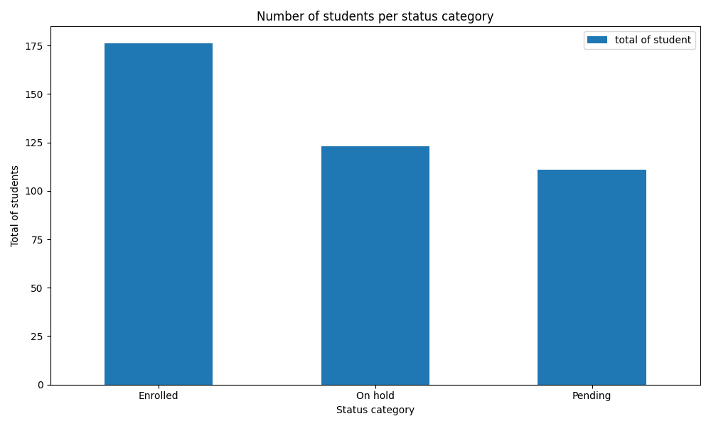

  #### Code used
  ##### Creating a bar chart to express students per status status

    fig, ax = plt.subplots(figsize=(10,6))

    student_per_status.plot(
      kind="bar",
      x="student_status",
      y="total_student",
      ax=ax,
      color="#1f77b4",
      rot=0,
      label="total of student"
    )
    ax.set_xlabel("Status category")
    ax.set_ylabel("Total of students")
    ax.set_title("Number of students per status category")
    
    plt.tight_layout()
    plt.show()

### 11. Course Modules
> Does each course have a consistent total_course_modules value?

   → No, it was found different total_course_modules for the same course.

   #### Code used

    modules_per_course = df2.groupby("course")["total_course_modules"].unique().reset_index()

> Are there courses where different students have different total module values?

   → Yes. By selecting student_id, course and total_course_modules columns we can stabilish that different students have different modules for the same course.

   #### Code used

    df2[["student_id", "course", "total_course_modules"]].head(30)

> Which records contain impossible module values?

  → Every course (Dutch, English, French, German, Italian, Japanese, portuguese and Spanish) has somehow an invalid module values such as 999 or negative values, non-numeric or even nan.

  #### Code used

  ##### Grouping dataset by course

    modules_per_course = df2.groupby("course")["total_course_modules"].unique().reset_index()

    modules_per_course.head(30)
  
> How many students have completed_modules > total_course_modules?
 
 → **36**

  #### Code used

  ##### Getting student_id, "total_course_modules", "completed_modules"

    student_module = df2_clean[["student_id", "total_course_modules", "completed_modules", "class_year"]]

   ##### Converting total_course_modules and completed_modules columns to numeric
   
    completed_modules_converted = pd.to_numeric(df2_clean["completed_modules"], errors="coerce") 

    total_course_module_converted = pd.to_numeric(df2_clean["total_course_modules"], errors="coerce")  

  ##### Creating a mask to compare values from both columns
   mask = (completed_modules_converted > total_course_module_converted)

  ##### saving result in a new variable 

    val_student_modules = student_module[mask]

    val_student_modules["student_id"].nunique()

> How many students have negative completed modules?

  → **7**
  #### Code used

  ##### Students with negative completed modules

    mask = (completed_modules_converted < 0)

    negative_modules = student_module[mask]

    negative_modules["student_id"].nunique()

> How many students have non-numeric module values?

  → **11**

  #### Code used

  ##### Students with non-numeric values
    mask = completed_modules_converted.isna() & student_module["completed_modules"].notna()

    non_numeric_modules = student_module[mask]

    non_numeric_modules["student_id"].nunique()

> What would be the most appropriate treatment for these records?

   → For any non-numeric value found in the columns I replaced for their correct numeric value using .replace(). Examples include values such as "twelve" in total_course_modules and "three" in "completed_modules".
    Regarding the negatives and discrepant values they were all replaced by missing values and the multiple values for the total_modules were flagged for manual investigation since it could mean different categories or level of courses, but the mode was peformed and saved in a new columns to have an idea of a more general standardized module for each course.

### 12. Age Validation
> What is the minimum age recorded?

   → -3
   #### Code used
   ##### Converting age column to numeric
    age_converted = pd.to_numeric(df2["age"], errors="coerce")

  ##### Minimun age recorded
    age_converted.min() 

> What is the maximum age recorded?

   → 150

  #### Code used
    age_converted.max()

> Are there clearly invalid ages?

   → Yes. By using value_counts() I could notice some invalid and unreal recorded ages.

   #### Code used
    age_converted.value_counts().sort_values(ascending=False)

> How many records contain:

**Negative ages?**

   → **12**

   #### Code used
    negative_ages = age_converted[age_converted < 0]

    len(negative_ages) #12

**Decimal ages?**

   → **25**

   #### Code used
    decimal_ages = age_converted[(age_converted % 1 !=0) & (age_converted.notna())]

    len(decimal_ages) #25

**Text instead of numbers?**

   → **14**

   #### Code used
    mask = age_converted.isna() & df2["age"].notna()

    non_numeric_ages = df2[mask]["age"]

    len(non_numeric_ages) #14

**Extremely high ages?**

   → It was found **24** records for the ageof 150.
   
   ##### Code used
    age_converted.value_counts().sort_values(ascending=False)

> What age range would be reasonable for this language school?

   → The reasonable age range for this school is **16** and **72**

   #### Code used
   ##### Stabilishng school age range ignoring outliers 
    age_range = (age_converted >= 1 ) & (age_converted <= 100 )

  ##### Lowest age
    lower_age = age_range.quantile(0.01)
  
  ##### Highest age
    upper_age = age_range.quantile(0.99)
    
    print(lower_age, upper_age)

> How many records fall outside your chosen range?

   → **90** records fall outside the resonable range of **16** and **72**.

   #### Code used
    (~age_range).sum()

> Explain your cleaning rule.

   → To clean this column I first replaced the invalid non-numeric record of "twenty" for "20", then I converted the age column to numeric data type and removed any value that fell outside the range 16-72 which were mostly values of -3 and 150 and also the removal of decimal ages were converted to integral numbers.

  #### Code used
  ##### Replacing non-numeric values for numeric ones
    non_numeric_ages.value_counts()
    df2["age"] = df2["age"].replace("twenty", "20")

  ##### Changing data type from string to numeric float
    df2["age"] = pd.to_numeric(df2["age"], errors="coerce")
    mask = (df2["age"] < 16) | (df2["age"] > 72)
    df2.loc[mask, "age"] = np.nan

  ##### Converting age column and removing .00 numbers
    df2["age"] = (
      pd.to_numeric(df2["age"], errors="coerce")
      .apply(lambda x: int(x) if pd.notna(x) else pd.NA)
      .astype("Int64")
    )

  ##### Changing columns from float to int
    columns_to_integer = ["total_course_modules", "completed_modules",    "extra_modules", "mode_course_modules"]

    for col in columns_to_integer:
      df2[col] = df2[col].astype("Int64")

### 13. Monthly Fees
> What data type should monthly_fee have?

   → Float

> How many different formats appear in this column?

   → 6 different formats were found. 

   #### Code used
    df2["monthly_fee"].value_counts()

> How many values cannot be converted into numeric values?

   → 62 values.

   #### Code used
  ##### Creating a temporary column monthly_fee_converted with the monthly fee values converted to numeric

    df2["monthly_fee_converted"] = pd.to_numeric(df2["monthly_fee"], errors="coerce")

  ##### Creating a mask with corresponding non-numeric values 

    mask = (df2["monthly_fee_converted"].isna()) & (df2["monthly_fee"].notna())

  ##### Saving values in a new variable fee_non_numeric

    fee_non_numeric = df2[mask]["monthly_fee"]

> Are there negative monthly fees?

   → Yes, there were found 19 negative records.

   #### Code used
    df2["monthly_fee"].value_counts()

> Are there unusually high monthly fees?

   → Values such as 9999 were found in 11 records.

> Can you convert all valid values into a standardized numeric format?

   → Yes, all values can be standardized to "xxx.xx" numeric format.

  #### Code used
    monthly_fee_standard = r"^[0-9]$"

> How should values such as the following be handled?

**__€450 | 450 EUR | 450.00 | 450,50 | four hundred__**

Explain your approach.

   → Such values were handled by removing currency signs, such as € and standardizing all values to numeric and data type as float. The non-numeric fees were replaced by their corresponding number.

   #### Code used
  ##### Converting monthly_fee in a new column
    df2["monthly_fee_converted"] = pd.to_numeric(df2["monthly_fee"], errors="coerce")

  ##### Mask to list non-numeric values
    mask = (df2["monthly_fee_converted"].isna()) & (df2["monthly_fee"].notna())

    fee_non_numeric = df2[mask]["monthly_fee"]

##### Replacing non-numerical values

    df2.loc[mask, "monthly_fee"] = df2["monthly_fee"].str.replace("four hundred", "400").str.strip()

  ##### Removing EUR and €
    df2.loc[mask, "monthly_fee"] = (df2["monthly_fee"].replace(r"EUR|, €|\$", "", regex=True).str.strip()) 

  ##### Converting "monthly_fee" column
    df2["monthly_fee"] = pd.to_numeric(df2["monthly_fee"], errors="coerce")

    mask_valid_fees = (df2["monthly_fee"] > 1) & (df2["monthly_fee"] < 9999)

    invalid_fees = df2[~mask_valid_fees]["monthly_fee"]

  ##### Replacing invalid fees
    df2.loc[~mask_valid_fees, "monthly_fee"] = np.nan

#### Visualization

The following histogram expresses the distribution of monthly fees discovered in the table

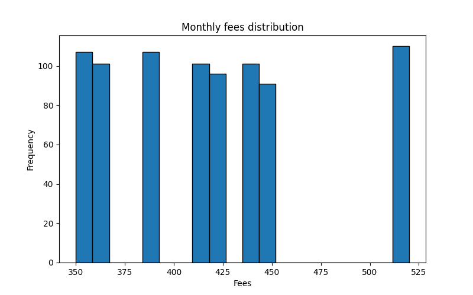

  #### Code used
  ##### Preparing data for visualization
    mask_fee = df2["monthly_fee"].notna()
    hist_fee = df2[mask_fee]["monthly_fee"]

  ##### Creating histogram
    plt.figure(figsize=(8,5))

    plt.hist(hist_fee, bins=20, color="#1f77b4",    edgecolor="black")

    plt.title("Monthly fees distribution")
    plt.xlabel("Fees")
    plt.ylabel("Frequency")

    plt.show()

### 14. Enrollment Dates
> How many different date formats exist?
   → 6

   #### Code used
   ##### Converting column in a new temporary variable
    enrollment_converted = pd.to_datetime(df2["enrollment_date"], errors="coerce")

##### Creating a mask to identify different formats
    mask_enrollment = (enrollment_converted.isna()) & (df2["enrollment_date"].notna())

##### Saving mask results
    multiple_enrollment_formats = df2[mask_enrollment]["enrollment_date"]

    multiple_enrollment_formats.head(30)
    multiple_enrollment_formats.value_counts() #5 +1 (right pattern YYYY-MM-DD)

> How many dates cannot be converted into valid dates?

   → **82**

   #### Code used
     len(multiple_enrollment_formats)

> Are there enrollment dates in the future?

   → No, the latest date found was 2026-07-28.

   #### Code used
    df2["enrollment_date"].dropna().sort_values(ascending=False).head(20)

> Are there enrollment dates outside the expected dataset period?
   → Yes, the earliest date found was 2017-01-01 but there are classes years from 2009 to even 2028 class projections.

  #### Code used
  ##### Checking latest class year
    df2["class_year"].dropna().sort_values(ascending=False).head(20)
 ##### Checking earliest class year
    df2["class_year"].dropna().sort_values(ascending=True).head(20)

> Can you convert all valid dates into:

 **_YYYY-MM-DD_**

   → All columns were standardized by applying replacements and conversions using pd.to_datetime() to different formats of date record found.

   #### Code used
   ##### Cleaning "not available" values

    df2.loc[mask_enrollment, "enrollment_date"] = df2["enrollment_date"].str.upper().replace("NOT-AVAILABLE", np.nan)

  ##### Replacing multiple date separators for "-"
    df2.loc[mask_enrollment, "enrollment_date"] = df2["enrollment_date"].str.upper().replace(r'[^A-Z0-9]', "-", regex=True)

  ##### Fixing dates in wrong format format YYYY-DD-MM to YYYY-MM-DD using regex
    df2.loc[mask_enrollment, "enrollment_date"] = df2["enrollment_date"].replace(r'^(\d{4})-(\d{2})-(\d{2})$', r'\1-\3-\2', regex=True )

  ##### Converting data using format="mixed" for mixed date formats
    df2["enrollment_date"] = pd.to_datetime(df2["enrollment_date"], format="mixed", errors="coerce")

  #### Standadizing dates to YYY-MM-DD format
    df2["enrollment_date"] = df2["enrollment_date"].dt.strftime("%Y-%m-%d")

> How many records have missing or invalid enrollment dates?

   → **58** values were found missing or in invalid formats and dates. 

   #### Code used
   ##### Converting values to datetime
   standardized_date = pd.to_datetime(multiple_enrollment_formats, format="mixed" ,errors="coerce")

   ##### Counting nans of invalid values
   standardized_date = pd.to_datetime(multiple_enrollment_formats, format="mixed" ,errors="coerce") #28

   ##### Counting NaNs from the columns "enrollment_date"
    df2["enrollment_date"].isna().sum() #58 // +30 missing values in the column

> Visualization

This bar chart expresses the number of enrollmentm per year

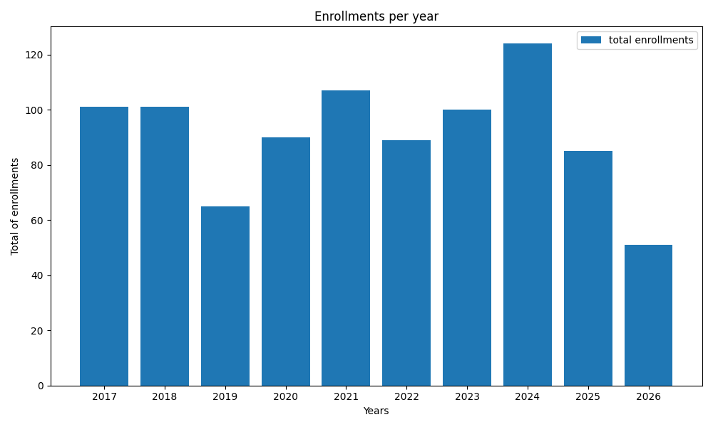

#### Code used
##### Preparing data: enrollments per year
    df2["enrollment_year"] = df2["enrollment_date"].astype(str).str.split("-").str[0]

    enrollment_viz = df2.groupby("enrollment_year")["enrollment_date"].count().dropna().reset_index()

    enrollment_viz.columns = ["enrollment_year","total_enrollments"]

    enrollment_viz.head(20)

  ##### Creating a barchart
    plt.figure(figsize=(10,6))

    plt.bar(enrollment_viz["enrollment_year"],
        enrollment_viz["total_enrollments"],
        color = "#1f77b4",
        label = "total enrollments")

    plt.xlabel("Years")
    plt.ylabel("Total of enrollments")
    plt.title("Enrollments per year")

    plt.legend()

    plt.tight_layout()
    plt.show()

## Part 5 — Data Integrity

### 15. Student–Class Relationship
> How many students appear to be assigned to a class that does not exist or has an invalid class ID?

   → **61** students are linked to invalid and empty class_id.

   #### Code used 
   ##### Students linked to no class or multiple classes
    class_per_student = df2.groupby("student_id")["class_id"].nunique().sort_values(ascending=False).reset_index()

    class_per_student.columns = ["student_id","total_associated_classes"]

    orphan_student = class_per_student[class_per_student["total_associated_classes"] < 1]

    len(orphan_student) #61

> Explain how you identified these records.

   → Such records were identified after cleaning such columns. Actions such as grouping and connecting valid students to their assigned classes helped with findinng and dealing with such inconsistencies that were later isolated in an audit report.

### 16. Student–Course–Class Consistency
Can you identify students whose:
 __Student → Class → Course__

  ##### Separating the columns

    student_class_course = df2[["student_id", "class_id", "course"]] # 925

  ##### Removing duplicates

    student_class_course = student_class_course.drop_duplicates() # 922

  ##### NaNs per column

    student_class_course["student_id"].isna().sum() # 172
    student_class_course["course"].isna().sum() 28
    student_class_course["class_id"].isna().sum() #67
 
> relationship appears inconsistent?

   → Empty values in the student_id column: **172**; in the course column: **28**; in the class_id: **67**. Also, an unique student_id was assigned to several other students, class_id and course, such records appear as an expessive inconsistency and they were isolated from the dataset. 

  ##### Records with inconsistencies

    student_per_class = df2.groupby("student_id")["class_id"].nunique()
student_per_class.head(40)

    len(df2[df2["student_id"] == "STU0123"][["student_id", "class_id","student_status", "course","student_email"]])

  ##### Students linked to missing/null classes
    orphan_student = class_per_student[class_per_student["total_associated_classes"] < 1]

    len(orphan_student) #61

  ##### Isolating inconsistent student_id
    mask = df2["student_id"] == "STU0123"
    df_auditing = df2[mask].copy()

  ##### Classes with no students
    orphan_class = students_per_class[students_per_class["student_id"] < 1]
    len(orphan_class) # 141
    students_per_class.head(40)

  ##### Valid student id linked to an inexistent class
    student_null_classes = df2[df2["class_id"].isna() & df2["student_id"].notna()][["student_id", "class_id"]]

    len(student_null_classes) #62

    student_null_classes.head(40)

  ##### Duplicated student-class

    student_class_duplicated = df2[df2.duplicated(subset=["student_id","class_id"], keep=False)][["student_id","class_id", "course", "student_email"]].sort_values(by="student_id")

    student_class_duplicated_list = student_class_duplicated["student_id"]

    len(student_class_duplicated) #32
    len(student_class_duplicated_list)
        df_auditing.to_csv("inconsistent_student_id_records_auditing_report.csv", index=False)

> How many potentially inconsistent records did you find?

   → During the data consistency and integrity process, there were found around **585** classes linked to only one student_id, **25** linked to **2**, **2** class_ids linked to **6** student_ids and **2** classes with either 3 or 7 linked student_ids. It was also identified **171** classes that has no students and **61** students with null classes or courses. Additionally, **32** duplicates on the student_id and class_id were found. Such records were manually investigated, and the students linked to an exhacerbate number of classes and courses, or unique classes being assigned to multiple courses or teachers were completely isolated from the dataset and saved in an auditing report for future analysis or investigation. In total, around **147** records were totally inconsistent in _student-class-course_ and _teacher-class-course_.

> How would you determine whether these are actual errors or legitimate records?

   → To determine the unusual records from the dataset it was applied a multi-step approach such as statistical analysis, cross-validation and the use of visualization to identify potential outliers.

   #### Code used
   ##### Using boxplot to identify outliers: students x class
   plt.figure(figsize=(8,5))
sns.boxplot(y="total_students", data=grouped_class)

  plt.title("Distribution of students per class")
  plt.show() 

  ##### Using boxplot to identify outliers: course x students
  plt.figure(figsize=(8,5))

  sns.boxplot(y = "total_courses", data=grouped_student_course)
  plt.title("Distribution of courses per student")
  plt.show()

### 17. Student–Teacher–Course Consistency
Identify teachers associated with multiple courses.

   → It was identified that all the teachers are associated with either 2 or 8 courses.

   #### Code used
   ##### Teacher-course
    courses_per_teacher = df2.groupby("teacher_id")["course"].nunique().reset_index().sort_values(by="course", ascending=False)

   ##### Teachers associated with multiple courses
    teacher_multiple_course = courses_per_teacher[courses_per_teacher["courses"] > 1][["teacher_id", "course"]]

    len(teacher_multiple_course) #85

> Identify teachers who appear to be teaching a course that does not match the course associated with their class.

  #### code used
  ##### Classes linked to multiple courses
    courses_per_class = df2.groupby("class_id")["course"].nunique().reset_index().sort_values(by="course", ascending=False)

    courses_per_class["course"].value_counts() #Multiple inconsistencies were found

  ##### Adding the length of unique courses associated with each class_id
    inconsistent_courses_per_class = courses_per_class[courses_per_class["course"] > 1]["class_id"]

  ##### Counting class_ids associated with multiple courses
    course_class_count = courses_per_class["course"].value_counts()
    print(course_class_count)

    len(course_class_count) # 775

  ###### Extracting class_ids associated with more than 1 course
    inconsistent_class_id = (courses_per_class[courses_per_class["course"] > 1]["class_id"]).tolist()

    len(inconsistent_class_id)

  ##### Extracting teachers associated with inconsistent classes
    inconsistent_teacher_class = df2[df2["class_id"].isin(inconsistent_class_id)][["class_id", "course","teacher_id"]].dropna()

  ##### Sorting values by class_id
inconsistent_teacher_class = inconsistent_teacher_class.sort_values(by="class_id", ascending=False)

> How many records are affected?

  → It was found that **64** unique teacher_ids are associated with classes that has between **2** or **9** courses associated with certain class_id. In total, 108 records are affected.

> Which teacher has the highest number of inconsistent associations?

  → The teacher with the id "TCH0025" has 4 records associated to an inconsistent class_id.

## Part 6 — Advanced Data Cleaning Challenges

### Challenge 1 — Hidden Duplicates
Exact duplicate detection is not enough.

> Can you identify potential duplicate students even when their records are not identical?

⇢ For example: *STU0045 | STU-0045 | stu0045 | STU0045*

  → It is possible by removing extra characteres and standardizing the ids.

> Could these represent the same student?

  → Yes, but since the standardization applied before, the students could be identified.

> Create a method to standardize the IDs and identify potential duplicates.

  → The standadization method applied to the student id consists in removing invalid and unnecessary characteres and capitilizing "STU". It was also necessary to fill some ids with extra zeros in order for it to obey the standard valid id "STU0000". All the ids that could not be validated were nullified. 

### Bonus

> What other columns could be used to determine whether two records represent the same student?

  → The column "e-mail" could be used to identify and differentiate students.

### Challenge 2 — Referential Integrity
> Treat the dataset as if it were part of a relational database.

 #### Assume the following relationships:

> *Students → Classes → Teachers → Courses*

> Can you identify records that violate referential integrity?

  → There were identified **241** records that either have invalid/null classes or teachers.

 Examples:
 *Student → Class that does not exist;*
*Class → Teacher that does not exist;*
*Record → Invalid course;*
*Record → Invalid teacher;*

> Calculate how many problematic relationships exist.

  → There were found 280 relationships where either the course, student, class or teacher is null or any of their relationships are invalid and inconsistent.

**Automatically correctable**: invalid values transformed to nans, typos and extra characteres.
Requires manual investigation: inconsistencies in student-class
Cannot be safely corrected: null values

  → During raw data cleaning more than 500 records could be automatically corrected but the ones that that were not possible they were converted to NaN values since it would require manual investigation or they could not be safely corrected. 

## Part 7 — Data Cleaning Visualizations

> Create the following visualizations where appropriate:

### Visualization 1 — Missing Values

> A bar chart showing:

> Column → Number of missing 

#### Code used

  ##### Preparing data
   missing_values = df1.isnull().sum().reset_index()

  ##### making the visuzalization as a bar graph
    missing_values.columns = ["columns", "missing_values"]
    plt.figure(figsize=[10,5])

    plt.barh(missing_values["columns"],       missing_values["missing_values"], label="missing values")

    plt.xlabel("Missing values")
    plt.ylabel("Dataset columns")
    plt.title("Distribution of missing values per column")

    plt.legend()
    plt.xticks(rotation=45)
    plt.show()

### Visualization 2 — Course Standardization

> Compare the number of raw course categories with the number of standardized course categories.
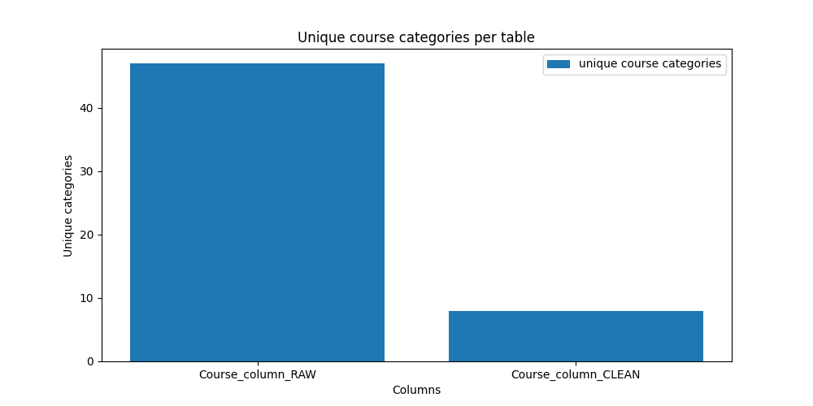

  #### Code used
  ##### Preparing data
    course_comp = { 
      "Course_column": [
      "Course_column_RAW",
      "Course_column_CLEAN",
    ], 
    "Unique_categories": [
      df1["course"].nunique(),
      df2_clean["course"].nunique(),
    ]
  
    } 

    course_comp = pd.DataFrame(course_comp)

  ##### --Bar graph
    plt.figure(figsize=[10,5])

    plt.bar(course_comp["Course_column"], course_comp["Unique_categories"], label="unique course categories")

    plt.xlabel("Columns")
    plt.ylabel("Unique categories")
    plt.title("Unique course categories per table")

    plt.legend()
    plt.xticks()
    plt.show()

### Visualization 3 — Student Status

> Show the number of students in each standardized status.

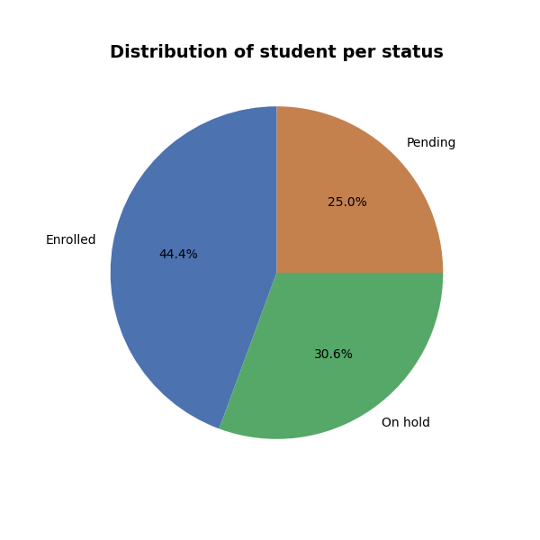

  #### Code used
  ##### Preparing data
    student_per_status = df2_clean["student_status"].value_counts()
  ##### Visualization
    student_per_status.plot(
      kind="pie",
      autopct="%1.1f%%", #show percentages
      startangle=90,
      figsize=(6,6),
      colors=["#4C72B0", "#55A868", "#C4814E"]
      )
    plt.title("Distribution of student per status", fontsize=14,    fontweight="bold",)
    plt.ylabel("")
    plt.show()

### Visualization 4 — Enrollment Dates

> number of records by enrollment year.
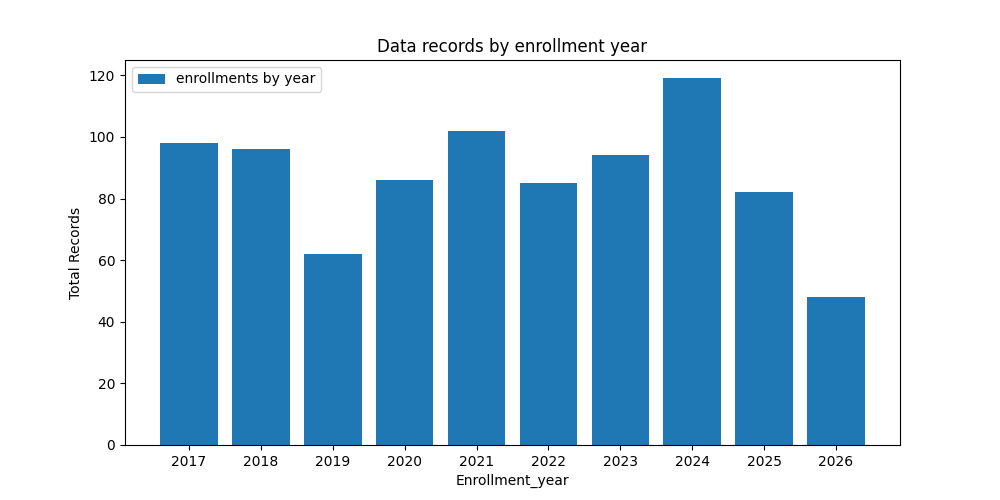
 
 #### Code used
 ##### Preparing data 
    records_enrollment_year = df2["enrollment_year"].value_counts().reset_index().sort_values(by="enrollment_year")

    print(records_enrollment_year)

  ##### Visualization
    plt.figure(figsize=(10,5))

    plt.bar(records_enrollment_year["enrollment_year"], records_enrollment_year["count"],  label="enrollments by year")

    plt.ylabel("Total Records")
    plt.xlabel("Enrollment_year")
    plt.title("Data records by enrollment year")

    plt.legend()
    plt.xticks(records_enrollment_year["enrollment_year"])
    plt.show()

### Visualization 5 — Monthly Fees

> Create a histogram showing the distribution of valid standardized monthly fees.
  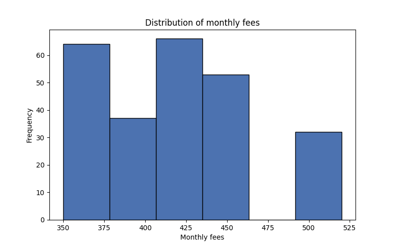

  #### Code used 
  ##### Creating a histogram 
    plt.figure(figsize=(8, 5))

    plt.hist(
      df2_clean["monthly_fee"],
      bins=6,
      color="#4C72B0",
      edgecolor="black"
    )

    plt.title("Distribution of monthly fees")
    plt.xlabel("Monthly fees")
    plt.ylabel("Frequency")
    plt.show()

#### 4. Standardization

Describe how you standardized:

- **Student IDs**: The students Ids were standardazed by using the referential STU0000. Typos, characters and invalid ids were all corrected or converted in NaNs.

- **Teacher IDs**: For the teacher's ids, it was used the reference TCH0000. A similar procedure used to standardize students Ids was also used here. The process of removing typos, extra characters and ivalid ids converted to NaNs was also performed. 

- **Class IDs**: The column of class_id was standardized by following the pattern C-YYYY-000. Registered ids that didn't follow this pattern were fixed or removed.

- **Course names**: Course names were all filtered to extract the available courses and then a process of cleaning, removing typos, extra numbers and characters found and invalid courses were removed.

- **Student statuses**: For the student status it was set the possible valid status a student could have and since it is a string of words, it was filtered the misspelled values and they were manually fixed. The invalid records were removed.

- **Dates**: The column date was first converted to date datatype and then a standardization using datetime so the dates would follow the standard of YYYY-MM-DD. Dates with invalid months, year or day were filtered and removed.

- **Monthly fees**: The Monthly fees column was converted to numeric and a search for outliers were performed. The values that fell much upper or lower the avarage fees were safely removed.

#### 5. Data Validation

Describe the validation performed for

  → **Age**: For age validation, it was performed outliers detection in order to remove values that fell extremely below or above the age rate and the logical possible ages.

  → **Course modules**: For the course modules, it was treated by correcting the discrepancies in the relation compleated modules-total modules. Some students had their compleated_modules bigger than the avarage total modules of the course. The values in compleated_modules that were higher than the total_course_modules had their differences saved in a new column names extra_modules.

  → **Classes**: Each class was standardized by removing unnecessary and invalid characters and checking wheater they followed the standard C-YYYY-000. Also, classes that were found linked to more than one courses were removed from the dataset and saved in an auditing dataset.

  → **Teachers**: The teacher_id column was standardized according to the standard id "TCH0000". Ids that were found to be invalid were converted to NaNs.

  → **Courses**: The Course columns has got typos or misspellings manually fixed and standardized to the 8 possible courses offered by the school. The courses names were kept in full with no abreviations and the invalid ones were safely removed.

  → **Student/class relationships**: Student_ids linked to an extreme amount of classes were safely analysed and removed from the dataset. Duplicates were also carefully analysed and the inconsistent records were all removed and saved in an auditing dataset found in the /dataset folder. 

  → **Teacher/course relationships**: To validade teacher and course, it was essential to isolate missing records found in one of or both columns. Such inconsistent records, specially from earlier than 2027 classes were saved in an audit report found in the datasets folder.

#### 6. Data Quality Issues

Describe the most important problems discovered in the dataset.

  → Problems with inconsistencies around the student_id, class_id, course and teacher_id were one of the most reccurrent and important problems dealt in the cleaning of this dataset. With the removal of these inconsistencies, better and more reliable analysis and insights extraction can be performed.

#### 7. Cleaning Decisions

For each major problem, explain:

Problem → Detection → Cleaning Method → Result

※ **Problem 1**: Inconsistency in the relationship student-course.
※ **Detection**: By using pandas to group unique student_ids and count courses associated to them,the result was expressses by using a boxplot visualization to detect outliers.
※ **Cleaning method**: Students with abnormal number of courses were isolated from the table and stored in an auditing report for future references and investigation. 
※ **Result**: A better flow on the relationships of the student-course relation was analysed and with the isolation of inconsistent rows the dataset got smaller.

※ **Problem 2**: Inconsistency in the reltionship class_id-teacher_id-course.
※ **Detection**: The same process applied in "problem 1" was applied here, and it was found that some class_ids were linked to multiple courses and consequently, mutiple teachers.
※ **Cleaning process**: Such inconsitencies were isolated, analysed and removed from the dataset. They were stored in an auditing table for future references and investigation. 
※ **Result**: Records that express a consistent relationship around class_id-teacher_id-course is noticeble in the dataset with the removal of the abnormal ones.

※ Problems concerning "student_email" and student_id were also found, but more like isolated inconsistencies which were detected by checking records linked to student_ids duplicates. Such records were removed from the dataset and saved in an auditing table. Other problems such as typos, misspellings wee detected using .value_counts() applied to columns and corrected by standardizing and nullifying invalid values.

#### 8. Before vs. After Metric

The following image is representative of metrics before and after dataset cleaning

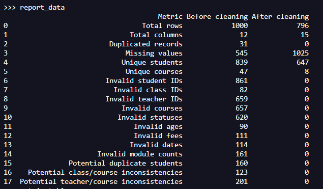
	
#### 9. Visualizations

Include the relevant visualizations created during the cleaning process.

#### 10. Conclusion

Answer the following:

> What were the three most important data-quality problems in the dataset?

→ Inconsistencies on student-class-teacher and class-course relation;

→ Typos and multiple formats for the columns student_id, class_id and enrollment_date;

→ No proper datatype for the columns;

> How did you identify them?

→ They were identified by performing data filtering in the columns. 

> How did you solve or handle them?

→ They were handled by being performing standardization of columns and datatypes, inconsistencies isolation and data auditing.

> Which problems could not be safely corrected automatically?

→ Problems such as class-course-teacher or student inconsistency, null values could not be corrected.